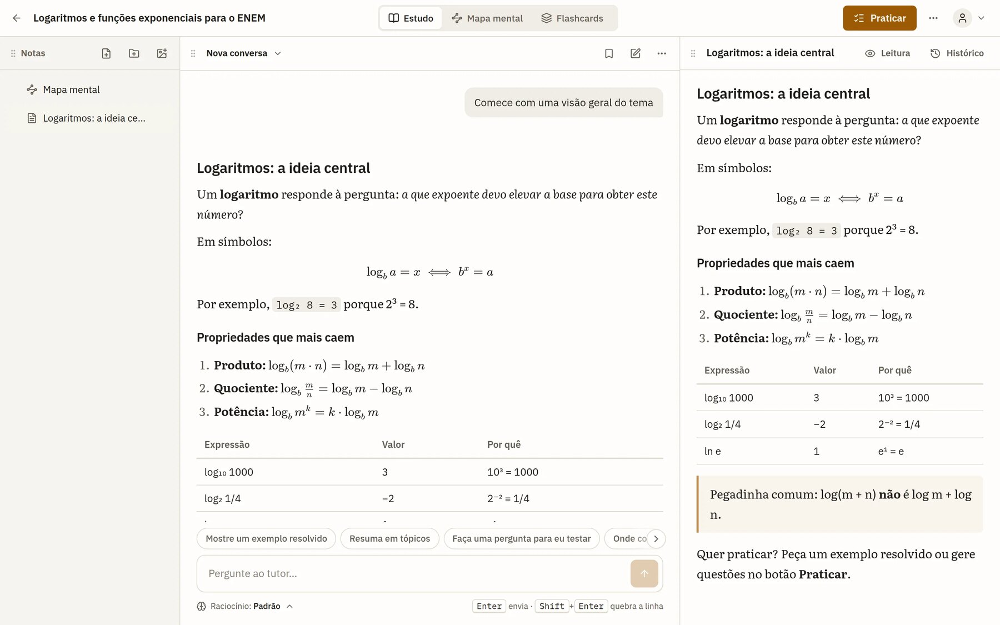
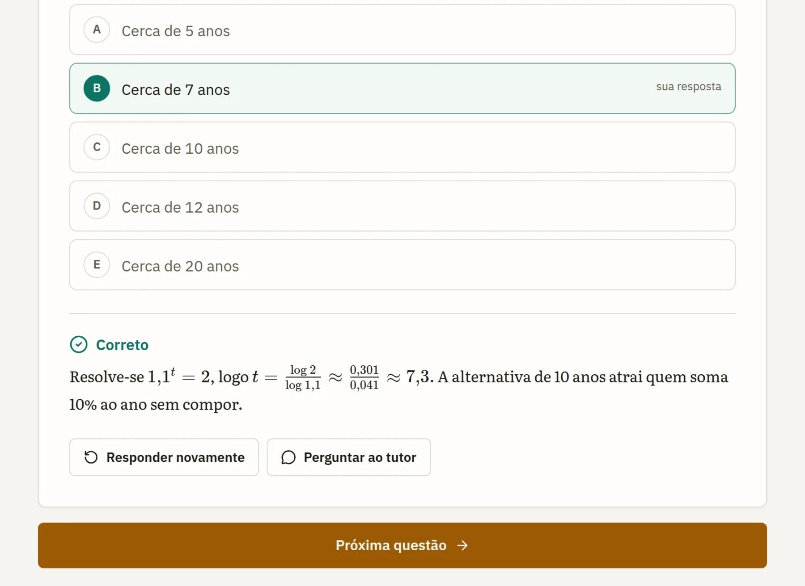
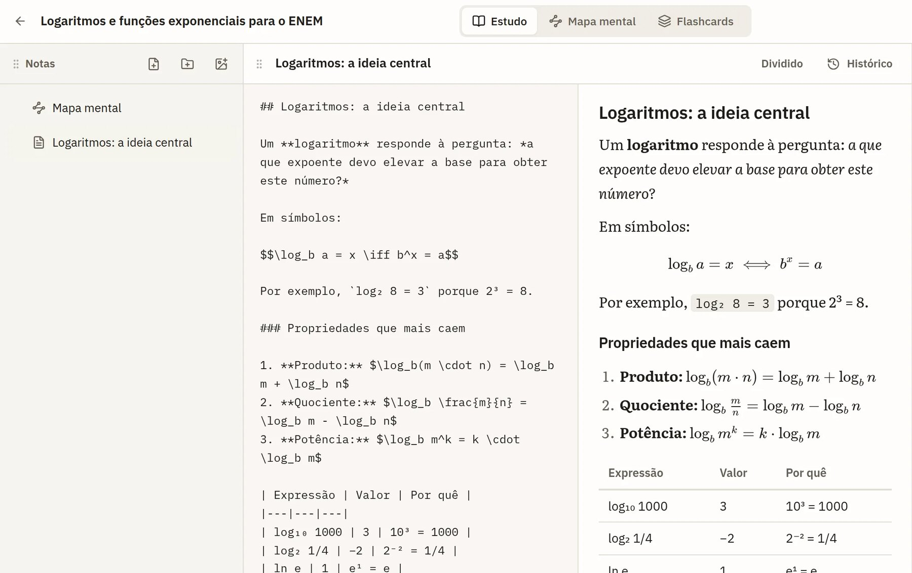
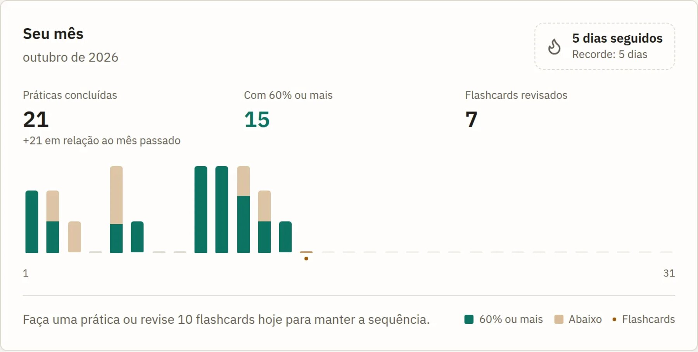

# Learnix

**An AI tutor that builds your study material, keeps your notes, and quizzes you on what you got wrong.**

Built for Brazilian students preparing for the ENEM · In development · [Preview →](https://learnix.bulga.top)

[Português](README.pt-BR.md) · [Product tour](docs/product.md) · [How it's built](docs/architecture.md)

<picture>
  <source media="(prefers-color-scheme: dark)" srcset="assets/hero-dark.jpg">
  
</picture>

> **About this repository.** Learnix is a commercial SaaS in active development, so the source code is private. This repository is the public showcase: what the product does, how it is engineered, and what I built. If you'd like a walkthrough or want something similar built for you, see [Work with me](#work-with-me).

## What it does

Most study tools are either a chatbot that forgets everything or a question bank that ignores what you already know. Learnix keeps one **workspace per topic** and ties the two together:

1. **Create a study** on any topic, for example "Logarithms for the ENEM".
2. **Talk to the tutor.** It builds the material step by step: an overview, then one concept at a time, with worked examples and rendered math. With web search on, it cites its sources.
3. **Keep what matters.** Tutor answers become Markdown notes with version history and branches. Every study also has an editable mind map and flashcards.
4. **Practice.** Questions are generated for the topic, in **training** mode (feedback after each question) or **mock exam** mode (timed, corrected at the end). You state your confidence on every answer, so the result separates *knowing* from *guessing*.
5. **Review mistakes.** Wrong answers come back as the focus of the next round.

There is also a guest demo that needs no account, standalone tests that adapt to your past attempts, a study streak, spaced-repetition flashcards and an optional leaderboard.

<picture>
  <source media="(prefers-color-scheme: dark)" srcset="assets/questao-dark.jpg">
  
</picture>

<table>
<tr>
<td width="50%" valign="top">

<picture>
  <source media="(prefers-color-scheme: dark)" srcset="assets/notas-dark.jpg">
  
</picture>

**Notes that stay.** Markdown with live preview, math, versions and branches.

</td>
<td width="50%" valign="top">

<picture>
  <source media="(prefers-color-scheme: dark)" srcset="assets/progresso-dark.jpg">
  
</picture>

**A reason to come back.** Monthly progress, a streak and a short daily flashcard session.

</td>
</tr>
</table>

## Engineering highlights

The interesting work is in making AI features dependable and affordable enough to sell. More detail in [docs/architecture.md](docs/architecture.md).

| Problem | What I built |
| --- | --- |
| Long AI answers get lost on refresh or restart | Every tutor reply is a **durable job** in the database, while the live view is a separate event stream. Clients can reconnect and replay the turn, or fall back to polling. Requests are idempotent. |
| LLM-written exam questions are often ambiguous or wrong | A three-stage pipeline: web **research** (cached per topic and shared), a **strict-schema author** step, then a **blind review** in which a reviewer answers every question *without* the answer key. Disagreements trigger a rewrite of just that question. |
| AI cost can quietly exceed the subscription price | Usage is metered as **real provider cost** against a monthly budget per plan. Long conversations are compacted to stay under the provider's long-context price tier. |
| Heavy front-end stacks are slow and fragile | Server-rendered Go templates with htmx and Alpine.js; fonts and libraries are self-hosted, with no CDN dependency. Math is rendered with KaTeX. |
| Trying a product shouldn't require signing up | A **zero-cost guest demo** from a prebuilt study, convertible in place to a real account without losing anything. |

## Tech stack

`Go` · `chi` · `templ` · `htmx` · `Alpine.js` · `Tailwind CSS` · `KaTeX` · `SQLite` · `Stripe` (subscriptions, REST API, no SDK) · LLMs through an OpenAI-compatible API · web search for cited research

## Work with me

I build backend-heavy products end to end: APIs, data models, AI features with sensible cost controls, billing, and a polished UI. If that sounds useful:

- Portfolio: [bulgaaw.com](https://bulgaaw.com)
- Email: [me@bulgaaw.com](mailto:me@bulgaaw.com)
- X: [@LinkyDevv](https://x.com/LinkyDevv)
- GitHub: [bulgadev](https://github.com/bulgadev)

## License

All rights reserved. The source code is private. The text and screenshots in this repository may not be reused without permission.
