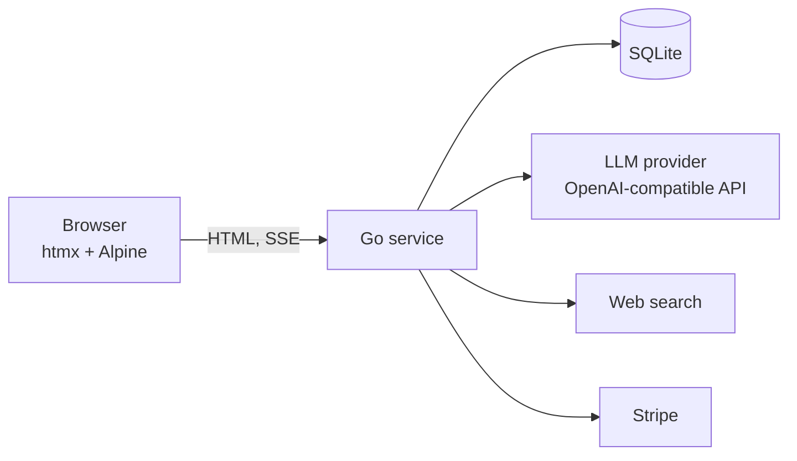

# Learnix: how it's built

A high-level tour of the engineering decisions. The source code is private, so this page covers design rather than code.

## Shape of the system

One Go service renders the UI on the server, talks to the model and search providers, and stores everything in SQLite. There is no separate front-end build to deploy: pages are server-rendered templates enhanced with htmx and Alpine.js, and all libraries and fonts are served from the same origin.

Choosing SQLite and a single binary was deliberate: the product is small enough that one machine is plenty, and it keeps deployment, backups and local development simple. The data layer is isolated behind repositories, so moving to a client-server database would be a contained change.

## The tutor chat: durable work, disposable stream

A chat reply can take tens of seconds and involve several tool calls, so it is treated as a **job**, not a request.

1. The client sends the question with an idempotency key. The server saves it as a queued turn and returns immediately.
2. A background worker runs the model with the study's tools (read or write a note, search the web, edit the mind map), up to a bounded number of tool rounds.
3. The result is saved with its sources and tool log, and the turn is marked succeeded or failed (with a retry action).

Progress is a **separate, best-effort stream** (server-sent events) held in memory: thinking summaries, tool starts and finishes, answer tokens. Events replay from the start, so a client that connects late or reconnects sees the whole turn. If the stream is gone, the client polls the database instead. The database row is the source of truth, and the stream is a convenience that is allowed to disappear. A restart marks interrupted turns as failed rather than leaving them hanging.

## Question generation: research, author, blind review

Generating good exam questions is harder than chatting, so it is a pipeline with checks:

1. **Research.** The model proposes search queries, which run in parallel; the pages are condensed into a cited brief. Briefs are **cached per normalised topic** and shared across students, which is safe because research only sees the topic, never a student's material. Repeat topics cost no search at all.
2. **Author.** One call writes the whole set under a **strict JSON schema**. Output is still validated (exactly five distinct options, a valid key, an explanation). Invalid items are rewritten individually instead of regenerating the set.
3. **Blind review.** A reviewer receives the questions **without the answer key or explanation** and answers them itself. It flags ambiguous, too-easy or wrong questions and may propose corrections. A question the reviewer answers differently from the key is rewritten. Because only problems are written back, a good set costs a few dozen output tokens to review.

Each stage can use a different model through configuration, and every generation logs where its time and cost went.

## Cost control

Selling AI by subscription only works if heavy users can't spend more than they pay.

- Usage is measured as **real provider cost** (not raw tokens, since output costs several times input and cached input a fraction), recorded per operation.
- Each plan has a **monthly budget**. When it is exhausted, AI endpoints stop; flashcards and notes keep working.
- The chat **compacts long conversations** so requests stay under the provider's long-context price tier.
- Prices are configurable, and the provider's reported cost is used when available.

## Accounts, billing and the demo

- Server-side sessions with signed cookies; no response ever reveals whether an email is registered.
- **Stripe** subscriptions through its REST API, with prices created on first use, Checkout and the customer portal, signature-verified webhooks, and a fallback that syncs state on page visits so deployments without a public webhook still stay correct.
- The **guest demo** copies a prebuilt study into a temporary guest account, so trying the product costs nothing. Guests are rate-limited, swept hourly, and can be converted to real accounts in place.

## UI principles

Reading comes first: study material is set in a reading serif at a comfortable line length, with light and dark themes and one accent colour reserved for the primary action on each screen. Motion is functional only, and reduced-motion settings are respected. Copy is plain and honest, with one word per concept across the interface.
